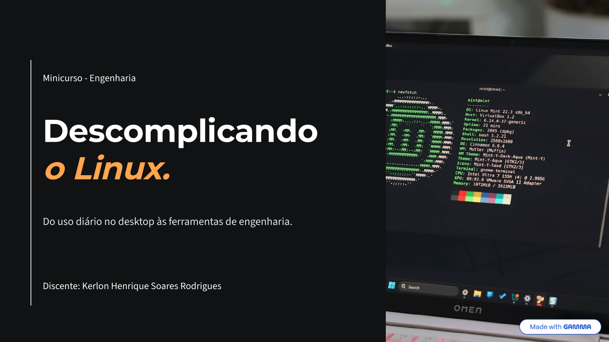

# Demystifying Linux: From Desktop to Engineering



Welcome to the hands-on repository for the **"Demystifying Linux: From Desktop to Engineering"** mini-course — a 2.5-hour workshop delivered in **Brazilian Portuguese** at the **VI Semana de Engenharia Elétrica**. It contains all code samples, automation scripts, Docker configurations, and reference material used during the presentation.

## Repository Structure

```text

├── 01-scripts/       # Bash and Python automation scripts
│   ├── log-report.sh # Didactic Bash example: fake log generator + analyzer
│   └── report.py     # Python system report generator
├── 02-docker/        # Dockerfile, static website and run script
│   ├── Dockerfile    # nginx:alpine image serving a static site
│   ├── index.html    # Simple website served by the container
│   └── setup.sh      # Build the image and run the container
├── assets/
│   └── slides-cover.png # Cover of the slide deck (shown above)
├── cheat-sheet.md    # Quick reference guide for essential Linux commands
└── demystifying-linux-slides.pdf  # Slide deck presented during the workshop

```

## Slides

The full slide deck presented during the workshop is available as
[demystifying-linux-slides.pdf](demystifying-linux-slides.pdf) — 49 slides, written in
Brazilian Portuguese and presented by Kerlon Henrique Soares Rodrigues. It follows the
same modules as this repository, so you can keep it open while working through the
scripts and the Docker example.

## Prerequisites & Setup

All required tools come pre-installed in the provided VirtualBox Virtual Machine (`.ova` image). If running on a custom environment, ensure you have:

* **OS:** Ubuntu 26.04.01 LTS
* **Tools:** `git`, `curl`, `micro`, `fastfetch`, `btop`, `yazi`, `lazygit`, `docker.io`, `python3`

## Workshop Quick Start

### 1. Clone the Repository

```bash
git clone [https://github.com/](https://github.com/)<your-username>/demystifying-linux-course.git
cd demystifying-linux-course

```

### 2. Automation Scripts (Module 2)

```bash
cd 01-scripts

# Grant execution permission and run the Bash log analyzer
chmod +x log-report.sh
./log-report.sh

# Run the Python report generator
python3 report.py

```

### 3. Docker Containerization (Module 4)

```bash
cd ../02-docker

# Grant execution permission, build the image and run the container
chmod +x setup.sh
./setup.sh

# Open the website served inside the container
# http://localhost:8080

# Stop and remove the container when done
docker stop linux-course-app && docker rm linux-course-app

```

### 4. Terminal User Interfaces (TUIs)

Explore terminal utilities during the workshop:

```bash
fastfetch    # Display system overview
btop         # Resource monitoring
yazi         # Terminal file manager
lazygit      # Terminal Git interface

```

## Cheat Sheet

Check [cheat-sheet.md](cheat-sheet.md) for a quick reference of the essential Linux commands covered during the workshop.
